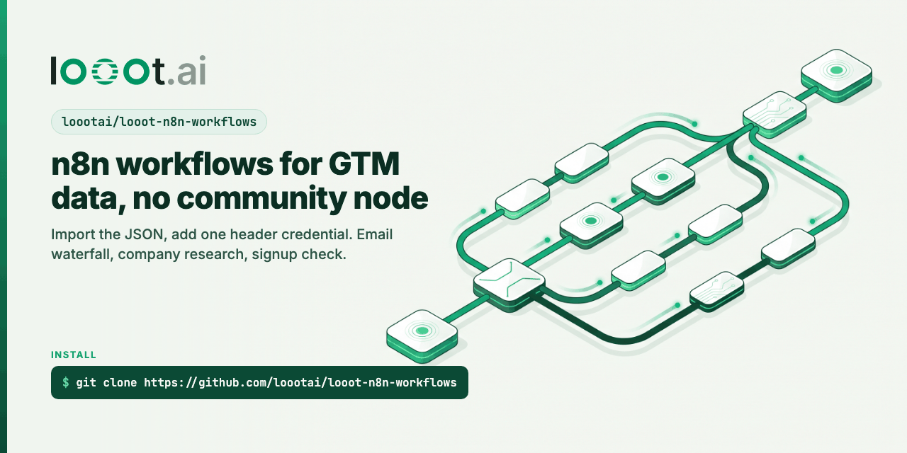

<p align="center"></p>

# looot-n8n-workflows

[](LICENSE) [](https://github.com/loootai/looot-n8n-workflows/releases) [](https://docs.looot.ai)

n8n workflows for GTM data. Every data call goes to [looot](https://looot.ai): one credential and one prepaid balance for 2,500+ data API endpoints from 90+ providers. A looot job run tries the next provider for the same job when one misses, inside a cost cap you set, and a failed call costs $0.

There are three sets:

- **One agent, one key.** Six rebuilds of popular n8n gallery templates that wire up several data providers one by one (Apify, SerpAPI, Exa, Firecrawl, Apollo, RapidAPI, Clearbit, PhantomBuster...). Each rebuild does the same job with one AI agent whose only data tool is the [verified looot node](https://n8n.io/integrations/looot/).
- **Plain workflows on the looot node.** Six GTM jobs with no AI step.
- **Core nodes only.** The first four workflows, which need no community node at all.

## One agent, one key

Counts come from each workflow's JSON on 2026-10-31, sticky notes not counted. Each README has the full table and says what the rebuild leaves out.

| Workflow | Rebuild of (views on n8n.io) | Nodes before / after | Data API accounts before / after | Most one run can spend |
| --- | --- | --- | --- | --- |
| [google-maps-leads-agent](workflows/google-maps-leads-agent) | [Scrape business leads from Google Maps](https://n8n.io/workflows/3443) (72,143) | 14 / 7 | 2 / 1 | $0.75 |
| [deep-research-agent](workflows/deep-research-agent) | [Open Deep Research](https://n8n.io/workflows/2883) (38,892) | 14 / 6 | 2 / 1 | $0.60 |
| [competitor-research-agent](workflows/competitor-research-agent) | [Competitor research with Exa.ai, Notion and AI agents](https://n8n.io/workflows/2354) (29,279) | 30 / 8 | 3 / 1 | $1.20 |
| [linkedin-lead-enrichment-agent](workflows/linkedin-lead-enrichment-agent) | [LinkedIn leads with Apollo.io, LinkedIn API, Mail.so](https://n8n.io/workflows/3791) (25,900) | 56 / 7 | 3 to 4 / 1 | $1.80 |
| [pre-call-social-brief](workflows/pre-call-social-brief) | [Social media activity of a company before a call](https://n8n.io/workflows/2125) (10,796) | 18 / 8 | 2 / 1 | $0.24 per company |
| [post-engagers-to-hubspot](workflows/post-engagers-to-hubspot) | [HubSpot contacts from LinkedIn post interactions](https://n8n.io/workflows/1323) (7,387) | 16 / 7 | 2 / 1 | $2.40 |

The "most" column is the agent's step limit times the $0.03 cap on each looot call. A typical run costs cents; see each README.

## Plain workflows on the looot node

| Workflow | What it does | Usual cost |
| --- | --- | --- |
| [form-lead-enrichment-hubspot](workflows/form-lead-enrichment-hubspot) | n8n form lead: verify email, enrich company, upsert HubSpot contact. Rebuild of [this template](https://n8n.io/workflows/2116), 2 data accounts down to 1. | $0.0034 per lead |
| [work-email-to-sheets](workflows/work-email-to-sheets) | Find and verify missing work emails in a Google Sheet, write them back | $0.005 per email |
| [competitor-news-slack](workflows/competitor-news-slack) | Daily Google News digest per competitor in Slack, new links only | $0.001 per competitor a day |
| [hiring-signal-alert](workflows/hiring-signal-alert) | Slack alert when a target account posts RevOps, SDR or sales roles | $0.0005 per account a day |
| [verify-before-instantly](workflows/verify-before-instantly) | Verify a sheet of emails, add only valid ones to an Instantly campaign | $0.00145 per address |
| [hubspot-company-tech-stack](workflows/hubspot-company-tech-stack) | Write the tech stack of new HubSpot companies to a property | under a cent per company |

And a building block: [looot-agent](workflows/looot-agent) is a sub-workflow any workflow can call with a task in plain words and a cost cap. It searches the catalog, inspects the price, runs, and returns the answer with its cost.

### Set up the looot-node workflows

1. In n8n: Settings > Community nodes > Install, search `looot`, pick the verified node (n8n-nodes-looot). For agents on self-hosted n8n, set `N8N_COMMUNITY_PACKAGES_ALLOW_TOOL_USAGE=true`.
2. Sign up at https://looot.ai, top up (from $5), create an agent token with `catalog.read`, `runs.read`, `runs.execute`, `usage.read`, and add a **looot API** credential with it.
3. Import a `workflow.json`. The yellow sticky note on the canvas lists the rest.

The JSON files carry no credentials and no account ids; spreadsheet, channel and campaign ids are `YOUR_...` placeholders.

## Core nodes only

These use only n8n's built-in nodes (Webhook, HTTP Request, Code, IF, Respond to Webhook, Schedule), so they run on n8n Cloud and on any self-hosted n8n without installing a community node.

| Workflow | In | Out | Usual cost | Most it can cost |
| --- | --- | --- | --- | --- |
| [work-email](workflows/work-email) | first name, last name, domain | work email + valid / invalid / catch_all / risky | about half a cent | $0.10 |
| [company-research](workflows/company-research) | domain | company card: size, industry, country, news, tech stack | under a cent | $0.15 |
| [signup-qualifier](workflows/signup-qualifier) | a new signup's email | person, company, ICP score, hot / warm / cold | under a cent, $0 for free mail | $0.10 |
| [google-rank-check](workflows/google-rank-check) | your domain + keywords, daily | position in Google's top 10 per keyword | $0.001 per keyword | $0.001 per keyword |

Prices are the cheapest listed on 2026-10-08 in looot's public catalog: https://api.looot.ai/v1/catalog/overview?depth=jobs (free, no token).

## Set up the core-node workflows (5 minutes)

1. Sign up at https://looot.ai, top up (from $5), and create an agent token with the scopes `catalog.read`, `runs.read`, `runs.execute` and `usage.read`.
2. In n8n: **Credentials > Add credential > Header Auth**. Name it `looot API`. Header name `Authorization`, value `Bearer <your token>`.
3. Download a `workflow.json` from [workflows/](workflows), then in n8n: **Workflows > Import from File**. Open each "HTTP Request" node that says looot and pick the `looot API` credential if n8n did not match it.
4. Activate the workflow and call the production webhook URL, for example:

```bash
curl -X POST https://<your-n8n>/webhook/looot/work-email \
  -H 'content-type: application/json' \
  -d '{"first_name":"Ada","last_name":"Lovelace","domain":"example.com"}'
```

## How each looot call looks

Every HTTP Request node sends the same shape, built by the Code node before it:

```
POST https://api.looot.ai/v1/runs?wait=60
Authorization: Bearer <token>            (from the Header Auth credential)
{
  "endpointId": "job:people.email.find",
  "input": {"first_name": "Ada", "last_name": "Lovelace", "domain": "example.com"},
  "idempotencyKey": "n8n-email-find:example.com:ada:lovelace",
  "fallback": {"enabled": true, "maxAttempts": 3, "maxCostUsd": 0.05}
}
```

- `fallback`: if the first provider misses or errors, looot tries the next one for the same job. `maxCostUsd` caps the whole walk.
- `idempotencyKey`: the same key with the same body returns the first run, so n8n retries and double submits are not charged twice.
- The node is set to never throw on a 4xx, so a 402 (balance empty) reaches the next Code node, which answers with the error and the top-up link instead of failing the execution.

## Why this is different

The usual DIY setup for these jobs in n8n is a chain of separate services: an email finder account, one or two verification services, a company data API, a SERP API. Each needs its own credential in n8n, has its own credit system and free-tier limit, and when one runs dry you rewire the workflow to the next one by hand. A run's cost shows up afterwards in several dashboards.

Here:

- One credential for every workflow. Each job has 4 to 21 providers behind it today.
- The fallback between providers happens inside one looot call, so the workflow has no branch per vendor.
- Each call carries a cost cap, and each README states the most one execution can spend.
- Failed calls and misses are free, and retries with the same key are not charged twice.
- Only core nodes, so nothing to install and nothing to approve on n8n Cloud.

What it does not do: free tiers are $0 and looot is not, so a few hundred lookups a month on free tiers is cheaper if you do not mind juggling accounts. Calls go through looot's servers.

## Edit and test

The Code node sources live in [code/](code) (shared helpers in `code/_shared`) and the workflow graphs in [scripts/build.mjs](scripts/build.mjs) (core nodes) and [scripts/build-node.mjs](scripts/build-node.mjs) (looot node). The JSON files are built from them:

```bash
npm run build          # writes every workflows/<name>/workflow.json
npm test               # node types and versions against n8n's source, connections, no credentials,
                       # sticky note rules, and every Code node run with fake inputs
npm run check:params   # every parameter name exists in the node's source (reads GitHub)
npm run scan           # leak scan, also a pre-commit hook: git config core.hooksPath .githooks
```

`test/n8n-node-versions.json` lists the node types and typeVersions n8n ships, read from n8n's source at the n8n@2.44.3 tag and from n8n-nodes-looot. Refresh it with `node scripts/fetch-node-versions.mjs <n8n commit>`.

What the tests do not cover: no workflow here was run end to end inside n8n, and no live looot, model or destination call was made. The canvas pictures are drawn from the JSON, not screenshots of n8n.

No dependencies. Node 20 or newer for the tests.

## Related

- [n8n-nodes-looot](https://github.com/loootai/n8n-nodes-looot): looot as an n8n community node.
- [looot-csv-enrich](https://github.com/loootai/looot-csv-enrich): the same jobs over a whole CSV from the terminal, quote first.
- [awesome-gtm](https://github.com/loootai/awesome-gtm): open-source GTM tools.

## License

MIT, copyright looot.
