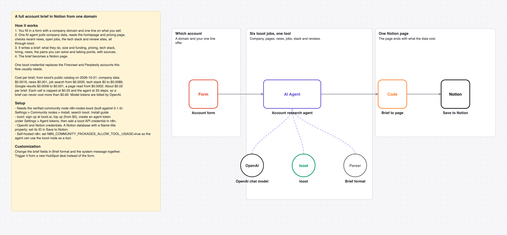

# Turn a company domain into a full account brief in Notion with one AI agent and looot

A form takes a company domain and your one line offer. One AI agent pulls company data, reads the homepage and pricing page, checks news, open jobs, the tech stack and reviews, and writes an account brief as a Notion page.

_The picture is drawn from `workflow.json`, not taken in n8n._

## Before and after

This rebuilds [Generate comprehensive business analysis reports with Gemini AI & Firecrawl](https://n8n.io/workflows/10391) by Daniel Agrici (937 views on n8n.io on 2026-10-31) with one AI agent and looot as its only data tool. Counts come from each workflow's JSON; sticky notes are not counted.

| | Original | This version |
| --- | --- | --- |
| Nodes | 23 | 7 |
| Data API accounts | 2 (Firecrawl, Perplexity) | 1 (looot) |
| Accounts to set up in total | 4 (Firecrawl, Google, Google Gemini, Perplexity) | 3 (looot API, OpenAI, Notion) |
| Cost cap per data call | none set in the JSON | $0.03 (Max Cost on the looot node) |

The original writes a long Google Doc through Gemini and emails it. This rebuild writes one Notion page of up to 2,000 characters focused on what a seller needs.

## Cost

Prices are the cheapest listed in looot's public catalog on 2026-10-31 (`GET https://api.looot.ai/v1/catalog/overview?depth=jobs`, no token). looot shows the price of every endpoint before a run, and a failed call costs $0.

| looot call | Price | Calls per run |
| --- | --- | --- |
| `job:company.enrich` | $0.0019 | 1 |
| `job:web.scrape.markdown` | from $0.0002 per page | 2 to 3 |
| `job:news.search` | $0.001 | 1 |
| `job:jobs.search` | from $0.0005 | 1 |
| `job:company.technographics` | $0 to $0.0089 depending on the provider | 1 |
| `job:google.serp.organic` | $0.0009 to $0.001 | 1 |

Typical: about $0.02 per brief. Most it can spend in looot calls: $0.60 (20 agent steps x $0.03 cap). Model tokens are billed by your model provider.

## Set up

1. Install the community node [n8n-nodes-looot](https://www.npmjs.com/package/n8n-nodes-looot) 0.1.4, verified by n8n: Settings > Community nodes > Install, search `looot`. On self-hosted n8n with an AI agent, also set `N8N_COMMUNITY_PACKAGES_ALLOW_TOOL_USAGE=true`.
2. Sign up at [looot.ai](https://looot.ai), top up (from $5) and create an agent token with `catalog.read`, `runs.read`, `runs.execute`, `usage.read`. In n8n add a **looot API** credential with it.
3. Import `workflow.json` (Workflows > Import from File) and pick your credentials: looot API, OpenAI, Notion.
4. Share a Notion database with your integration (it needs a Name title property) and set its ID in **Save to Notion**.

## What was checked

- `npm test`: node types and typeVersions against n8n's source at the n8n@2.44.3 tag and n8n-nodes-looot 0.1.4, connections, no credentials or ids in the JSON, sticky note rules, and every Code node run with fake inputs.
- `npm run check:params`: every parameter name exists in the node's source at that tag.
- Not run end to end in n8n. No live looot, model or destination calls were made.
