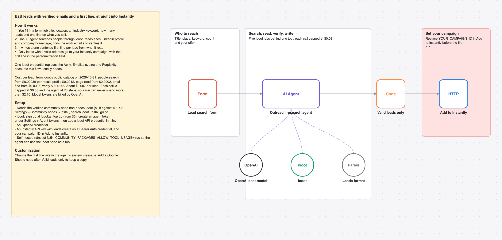

# Find B2B leads, verify their emails and add them to an Instantly campaign with one AI agent and looot

A form takes a job title, a location, a keyword, a count and your offer. One AI agent finds the people, reads their profile and company homepage, finds and verifies the work email, writes a first line, and the valid leads go to an Instantly campaign.

_The picture is drawn from `workflow.json`, not taken in n8n._

## Before and after

This rebuilds [Automate lead generation & personalized outreach with Apollo, AI, and Instantly.ai](https://n8n.io/workflows/6983) by Ruben AI (4,855 views on n8n.io on 2026-10-31) with one AI agent and looot as its only data tool. Counts come from each workflow's JSON; sticky notes are not counted.

| | Original | This version |
| --- | --- | --- |
| Nodes | 139 | 7 |
| Data API accounts | 4 (Apify, Emailable, Jina, Perplexity) | 1 (looot) |
| Accounts to set up in total | 7 (Airtable, Apify, Emailable, Instantly, Jina, OpenAI, Perplexity) | 3 (looot API, OpenAI, Instantly API key as Bearer Auth) |
| Cost cap per data call | none set in the JSON | $0.03 (Max Cost on the looot node) |

The original is 139 nodes: an Airtable base as the CRM, Apollo scraped through Apify, Emailable for verification, Jina and Perplexity for research, and Instantly reply handling through a webhook. This rebuild covers search, research, verification, the first line and the push to Instantly. It keeps no Airtable base and does not handle replies.

## Cost

Prices are the cheapest listed in looot's public catalog on 2026-10-31 (`GET https://api.looot.ai/v1/catalog/overview?depth=jobs`, no token). looot shows the price of every endpoint before a run, and a failed call costs $0.

| looot call | Price | Calls per run |
| --- | --- | --- |
| `job:people.search` | from $0.00036 per result | 1 |
| `job:linkedin.person.profile` | $0.0012 | 1 per person |
| `job:web.scrape.markdown` | from $0.0002 per page | 1 per person |
| `job:people.email.find` | from $0.0036 | 1 per person |
| `job:people.email.verify` | $0.00145 | 1 per email found |

Typical: about $0.007 per lead, $0.07 for 10. Most it can spend in looot calls: $2.10 (70 agent steps x $0.03 cap). Model tokens are billed by your model provider.

## Set up

1. Install the community node [n8n-nodes-looot](https://www.npmjs.com/package/n8n-nodes-looot) 0.1.4, verified by n8n: Settings > Community nodes > Install, search `looot`. On self-hosted n8n with an AI agent, also set `N8N_COMMUNITY_PACKAGES_ALLOW_TOOL_USAGE=true`.
2. Sign up at [looot.ai](https://looot.ai), top up (from $5) and create an agent token with `catalog.read`, `runs.read`, `runs.execute`, `usage.read`. In n8n add a **looot API** credential with it.
3. Import `workflow.json` (Workflows > Import from File) and pick your credentials: looot API, OpenAI, Instantly API key as Bearer Auth.
4. Set YOUR_CAMPAIGN_ID in **Add to Instantly**.

## What was checked

- `npm test`: node types and typeVersions against n8n's source at the n8n@2.44.3 tag and n8n-nodes-looot 0.1.4, connections, no credentials or ids in the JSON, sticky note rules, and every Code node run with fake inputs.
- `npm run check:params`: every parameter name exists in the node's source at that tag.
- Not run end to end in n8n. No live looot, model or destination calls were made.
