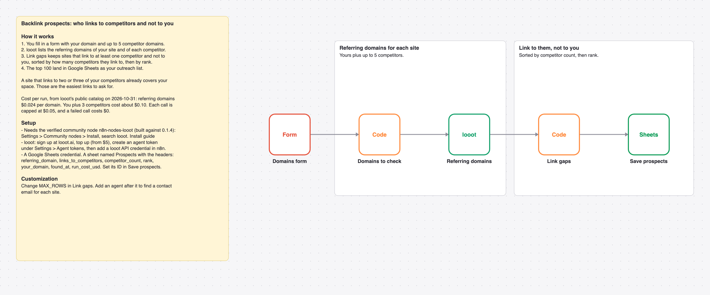

# Find sites that link to your competitors but not to you with looot backlink data into Google Sheets

A form takes your domain and up to 5 competitors. looot lists the referring domains of each, and the sites that link to competitors but not to you land in Google Sheets, most competitors first.

_The picture is drawn from `workflow.json`, not taken in n8n._

## Cost

Prices are the cheapest listed in looot's public catalog on 2026-10-31 (`GET https://api.looot.ai/v1/catalog/overview?depth=jobs`, no token). looot shows the price of every endpoint before a run, and a failed call costs $0.

| looot call | Price | Calls per run |
| --- | --- | --- |
| `job:backlinks.referring.domains` | $0.024 | 1 per domain |

Typical: about $0.10 for you plus 3 competitors. Most it can spend in looot calls: $0.30 per run (6 domains x $0.05 cap).

## Set up

1. Install the community node [n8n-nodes-looot](https://www.npmjs.com/package/n8n-nodes-looot) 0.1.4, verified by n8n: Settings > Community nodes > Install, search `looot`.
2. Sign up at [looot.ai](https://looot.ai), top up (from $5) and create an agent token with `catalog.read`, `runs.read`, `runs.execute`, `usage.read`. In n8n add a **looot API** credential with it.
3. Import `workflow.json` (Workflows > Import from File) and pick your credentials: looot API, Google Sheets.
4. Create a sheet tab named Prospects with the headers referring_domain, links_to_competitors, competitor_count, rank, your_domain, found_at, run_cost_usd, and set its ID in **Save prospects**.

## What was checked

- `npm test`: node types and typeVersions against n8n's source at the n8n@2.44.3 tag and n8n-nodes-looot 0.1.4, connections, no credentials or ids in the JSON, sticky note rules, and every Code node run with fake inputs.
- `npm run check:params`: every parameter name exists in the node's source at that tag.
- Not run end to end in n8n. No live looot, model or destination calls were made.
