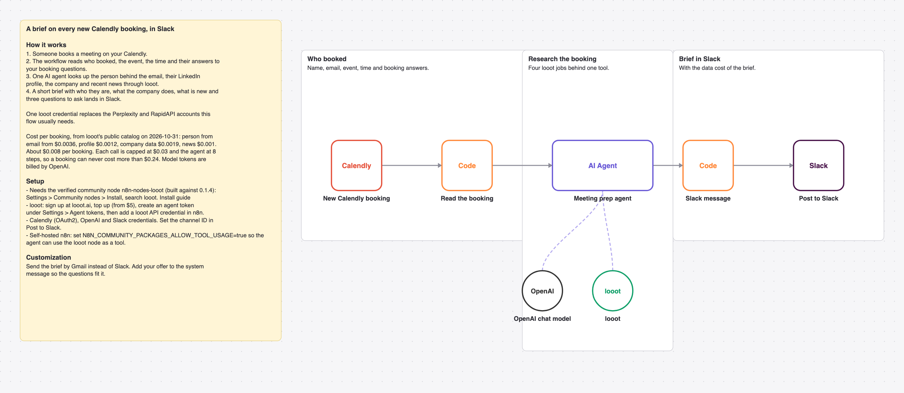

# Post a research brief to Slack when someone books a Calendly meeting, with one AI agent and looot

When someone books on Calendly, one AI agent looks up the person, their LinkedIn profile, the company and recent news, and posts a short brief with questions that use their booking answers to Slack.

_The picture is drawn from `workflow.json`, not taken in n8n._

## Before and after

This rebuilds [Pre-meeting lead research agent with Calendly, Perplexity & RapidAPI](https://n8n.io/workflows/8957) by Fabian Herhold (603 views on n8n.io on 2026-10-31) with one AI agent and looot as its only data tool. Counts come from each workflow's JSON; sticky notes are not counted.

| | Original | This version |
| --- | --- | --- |
| Nodes | 19 | 7 |
| Data API accounts | 2 (Perplexity, RapidAPI) | 1 (looot) |
| Accounts to set up in total | 5 (Calendly, OpenAI, Perplexity, RapidAPI, Slack) | 4 (Calendly, looot API, OpenAI, Slack) |
| Cost cap per data call | none set in the JSON | $0.03 (Max Cost on the looot node) |

The original runs three sub-agents with Perplexity and a RapidAPI people endpoint. This rebuild is one agent with one tool.

## Cost

Prices are the cheapest listed in looot's public catalog on 2026-10-31 (`GET https://api.looot.ai/v1/catalog/overview?depth=jobs`, no token). looot shows the price of every endpoint before a run, and a failed call costs $0.

| looot call | Price | Calls per run |
| --- | --- | --- |
| `job:people.enrich.by-email` | from $0.0036 | 1 |
| `job:linkedin.person.profile` | $0.0012 | 0 to 1 |
| `job:company.enrich` | $0.0019 | 0 to 1 |
| `job:news.search` | $0.001 | 0 to 1 |

Typical: about $0.008 per booking. Most it can spend in looot calls: $0.24 per booking (8 agent steps x $0.03 cap). Model tokens are billed by your model provider.

## Set up

1. Install the community node [n8n-nodes-looot](https://www.npmjs.com/package/n8n-nodes-looot) 0.1.4, verified by n8n: Settings > Community nodes > Install, search `looot`. On self-hosted n8n with an AI agent, also set `N8N_COMMUNITY_PACKAGES_ALLOW_TOOL_USAGE=true`.
2. Sign up at [looot.ai](https://looot.ai), top up (from $5) and create an agent token with `catalog.read`, `runs.read`, `runs.execute`, `usage.read`. In n8n add a **looot API** credential with it.
3. Import `workflow.json` (Workflows > Import from File) and pick your credentials: Calendly (OAuth2), looot API, OpenAI, Slack.
4. Set the channel ID in **Post to Slack**. Activate the workflow so n8n registers the Calendly webhook.

## What was checked

- `npm test`: node types and typeVersions against n8n's source at the n8n@2.44.3 tag and n8n-nodes-looot 0.1.4, connections, no credentials or ids in the JSON, sticky note rules, and every Code node run with fake inputs.
- `npm run check:params`: every parameter name exists in the node's source at that tag.
- Not run end to end in n8n. No live looot, model or destination calls were made.
