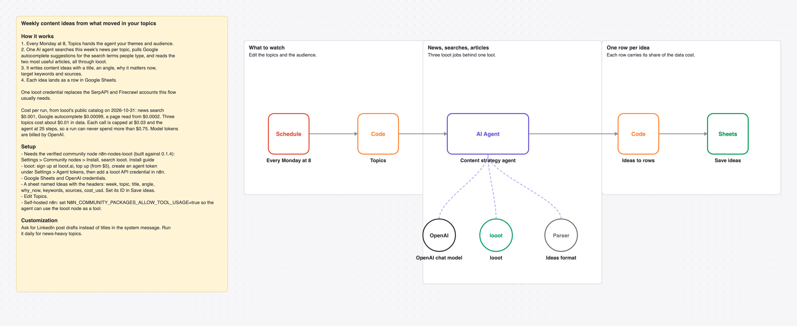

# Turn this week's news on your topics into content ideas in Google Sheets with one AI agent and looot

Every Monday, one AI agent reads this week's news on your topics, the Google autocomplete suggestions for them and the best two articles, then writes content ideas into Google Sheets.

_The picture is drawn from `workflow.json`, not taken in n8n._

## Before and after

This rebuilds [Automated content strategy with Google Trends, News, Firecrawl & Claude AI](https://n8n.io/workflows/7372) by Allan Vaccarizi (5,310 views on n8n.io on 2026-10-31) with one AI agent and looot as its only data tool. Counts come from each workflow's JSON; sticky notes are not counted.

| | Original | This version |
| --- | --- | --- |
| Nodes | 37 | 8 |
| Data API accounts | 2 (Firecrawl, SerpAPI) | 1 (looot) |
| Accounts to set up in total | 4 (Anthropic, Firecrawl, Google, SerpAPI) | 3 (looot API, OpenAI, Google Sheets) |
| Cost cap per data call | none set in the JSON | $0.03 (Max Cost on the looot node) |

The original pulls Google Trends interest data through SerpAPI. looot lists a Google Trends job, but at $0.09 a call it is above this template's $0.03 cap, so the rebuild uses Google autocomplete suggestions and news instead. It has no interest-over-time numbers.

## Cost

Prices are the cheapest listed in looot's public catalog on 2026-10-31 (`GET https://api.looot.ai/v1/catalog/overview?depth=jobs`, no token). looot shows the price of every endpoint before a run, and a failed call costs $0.

| looot call | Price | Calls per run |
| --- | --- | --- |
| `job:news.search` | $0.001 | 1 per topic |
| `job:google.keywords.suggestions` | $0.00099 | 1 per topic |
| `job:web.scrape.markdown` | from $0.0002 per page | 2 per topic |

Typical: about $0.01 for 3 topics. Most it can spend in looot calls: $0.75 (25 agent steps x $0.03 cap). Model tokens are billed by your model provider.

## Set up

1. Install the community node [n8n-nodes-looot](https://www.npmjs.com/package/n8n-nodes-looot) 0.1.4, verified by n8n: Settings > Community nodes > Install, search `looot`. On self-hosted n8n with an AI agent, also set `N8N_COMMUNITY_PACKAGES_ALLOW_TOOL_USAGE=true`.
2. Sign up at [looot.ai](https://looot.ai), top up (from $5) and create an agent token with `catalog.read`, `runs.read`, `runs.execute`, `usage.read`. In n8n add a **looot API** credential with it.
3. Import `workflow.json` (Workflows > Import from File) and pick your credentials: looot API, OpenAI, Google Sheets.
4. Create a sheet tab named Ideas with the headers week, topic, title, angle, why_now, keywords, sources, cost_usd, set its ID in **Save ideas**, and edit **Topics**.

## What was checked

- `npm test`: node types and typeVersions against n8n's source at the n8n@2.44.3 tag and n8n-nodes-looot 0.1.4, connections, no credentials or ids in the JSON, sticky note rules, and every Code node run with fake inputs.
- `npm run check:params`: every parameter name exists in the node's source at that tag.
- Not run end to end in n8n. No live looot, model or destination calls were made.
