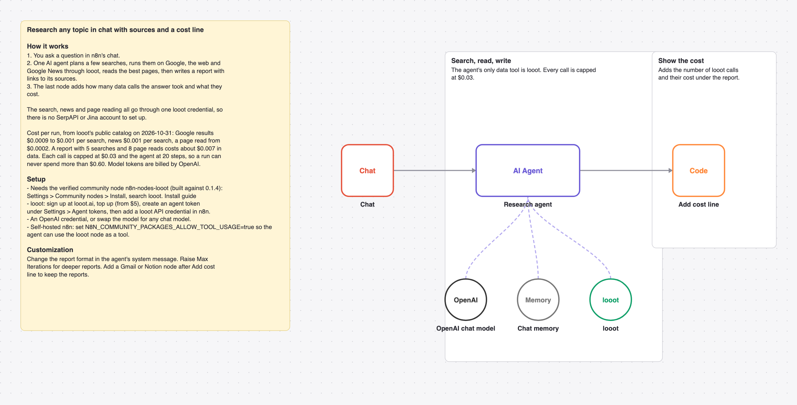

# Research any topic with one AI agent that searches Google, news and web pages through looot

Ask a question in n8n chat. One AI agent plans searches, runs them on Google, the web and Google News, reads the best pages and answers with sources and a cost line.

_The picture is drawn from `workflow.json`, not taken in n8n._

## Before and after

This rebuilds [Open deep research - AI-powered autonomous research workflow](https://n8n.io/workflows/2883) by Leonard (38,892 views on n8n.io on 2026-10-31) with one AI agent and looot as its only data tool. Counts come from each workflow's JSON; sticky notes are not counted.

| | Original | This version |
| --- | --- | --- |
| Nodes | 14 | 6 |
| Data API accounts | 2 (Jina, SerpAPI) | 1 (looot) |
| Accounts to set up in total | 3 (Jina, OpenRouter, SerpAPI) | 2 (looot API, OpenAI) |
| Cost cap per data call | none set in the JSON | $0.03 (Max Cost on the looot node) |

The original runs a fixed chain (query generation, SerpAPI, Jina, a Wikipedia tool, report writer) with OpenRouter. This one is a single agent with memory, so a follow-up question reuses the context. It has no Wikipedia tool.

## Cost

Prices are the cheapest listed in looot's public catalog on 2026-10-31 (`GET https://api.looot.ai/v1/catalog/overview?depth=jobs`, no token). looot shows the price of every endpoint before a run, and a failed call costs $0.

| looot call | Price | Calls per run |
| --- | --- | --- |
| `job:google.serp.organic` | $0.0009 to $0.001 per search | 3 to 6 |
| `job:news.search` | $0.001 per search | 0 to 2 |
| `job:web.search` | from $0 per result | 0 to 2 |
| `job:web.scrape.markdown` | from $0.0002 per page | 5 to 8 |

Typical: about $0.007 per report. Most one run can spend in looot calls: $0.60 (20 agent steps x $0.03 cap). Model tokens are billed by your model provider.

## Set up

1. Install the community node [n8n-nodes-looot](https://www.npmjs.com/package/n8n-nodes-looot) 0.1.4, verified by n8n: Settings > Community nodes > Install, search `looot`. On self-hosted n8n with an AI agent, also set `N8N_COMMUNITY_PACKAGES_ALLOW_TOOL_USAGE=true`.
2. Sign up at [looot.ai](https://looot.ai), top up (from $5) and create an agent token with `catalog.read`, `runs.read`, `runs.execute`, `usage.read`. In n8n add a **looot API** credential with it.
3. Import `workflow.json` (Workflows > Import from File) and pick your credentials: looot API, OpenAI.
4. Nothing beyond the credentials. Open the chat on the trigger node.

## What was checked

- `npm test`: node types and typeVersions against n8n's source at the n8n@2.44.3 tag and n8n-nodes-looot 0.1.4, connections, no credentials or ids in the JSON, sticky note rules, and every Code node run with fake inputs.
- `npm run check:params`: every parameter name exists in the node's source at that tag.
- Not run end to end in n8n. No live looot, model or destination calls were made.
