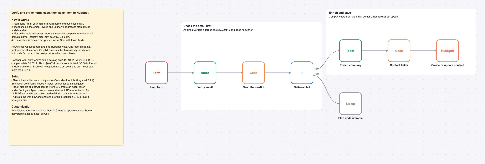

# Verify and enrich inbound form leads with looot before they reach HubSpot

An n8n form collects name and business email. looot verifies the email, enriches the company from the domain and the contact goes to HubSpot. Undeliverable addresses stop early.

_The picture is drawn from `workflow.json`, not taken in n8n._

## Before and after

This rebuilds [Verify emails & enrich new form leads and save them to HubSpot](https://n8n.io/workflows/2116) by Niklas Hatje (3,432 views on n8n.io on 2026-10-31) with one AI agent and looot as its only data tool. Counts come from each workflow's JSON; sticky notes are not counted.

| | Original | This version |
| --- | --- | --- |
| Nodes | 7 | 8 |
| Data API accounts | 2 (Clearbit, Hunter) | 1 (looot) |
| Accounts to set up in total | 3 (Clearbit, HubSpot, Hunter) | 2 (looot API, HubSpot) |
| Cost cap per data call | none set in the JSON | $0.05 (Max Cost on the looot node) |

Same job as the original, with no AI step. It has one node more than the original (a Code node reads the verdict) and one account fewer.

## Cost

Prices are the cheapest listed in looot's public catalog on 2026-10-31 (`GET https://api.looot.ai/v1/catalog/overview?depth=jobs`, no token). looot shows the price of every endpoint before a run, and a failed call costs $0.

| looot call | Price | Calls per run |
| --- | --- | --- |
| `job:people.email.verify` | $0.00145 | 1 |
| `job:company.enrich` | $0.0019 | 1 if deliverable |

Typical: about $0.0034 per deliverable lead. Most one run can spend in looot calls: $0.10 (2 calls x $0.05 cap).

## Set up

1. Install the community node [n8n-nodes-looot](https://www.npmjs.com/package/n8n-nodes-looot) 0.1.4, verified by n8n: Settings > Community nodes > Install, search `looot`. On self-hosted n8n with an AI agent, also set `N8N_COMMUNITY_PACKAGES_ALLOW_TOOL_USAGE=true`.
2. Sign up at [looot.ai](https://looot.ai), top up (from $5) and create an agent token with `catalog.read`, `runs.read`, `runs.execute`, `usage.read`. In n8n add a **looot API** credential with it.
3. Import `workflow.json` (Workflows > Import from File) and pick your credentials: looot API, HubSpot (private app token).
4. Activate the workflow and use the form's production URL.

## What was checked

- `npm test`: node types and typeVersions against n8n's source at the n8n@2.44.3 tag and n8n-nodes-looot 0.1.4, connections, no credentials or ids in the JSON, sticky note rules, and every Code node run with fake inputs.
- `npm run check:params`: every parameter name exists in the node's source at that tag.
- Not run end to end in n8n. No live looot, model or destination calls were made.
