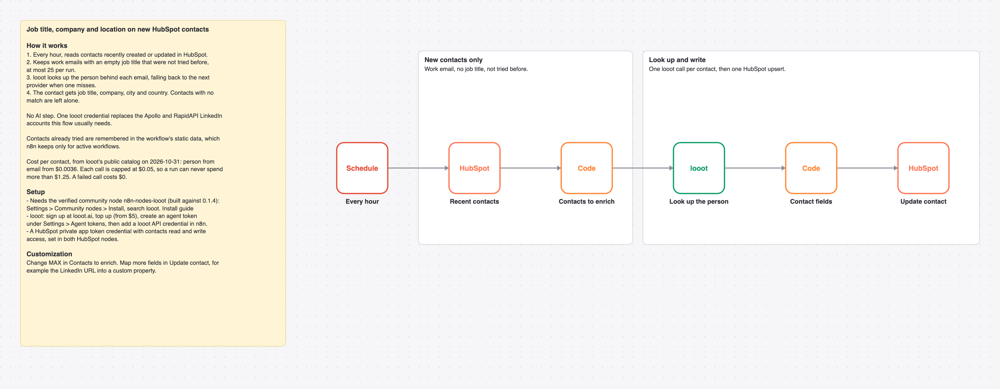

# Fill in job title, company and location on new HubSpot contacts with looot person enrichment

Every hour, new HubSpot contacts with a work email and no job title get looked up by email through looot, and the contact gets job title, company, city and country.

_The picture is drawn from `workflow.json`, not taken in n8n._

## Before and after

This rebuilds [Comprehensive contact enrichment with Apollo, LinkedIn, and GPT-4o for HubSpot](https://n8n.io/workflows/6103) by Interlock GTM (1,070 views on n8n.io on 2026-10-31) with looot as its only data source. Counts come from each workflow's JSON; sticky notes are not counted.

| | Original | This version |
| --- | --- | --- |
| Nodes | 19 | 6 |
| Data API accounts | 2 (Apollo, RapidAPI) | 1 (looot) |
| Accounts to set up in total | 4 (Apollo, HubSpot, OpenAI, RapidAPI) | 2 (looot API, HubSpot) |
| Cost cap per data call | none set in the JSON | $0.05 (Max Cost on the looot node) |

The original is a sub-workflow that searches Apollo and a RapidAPI LinkedIn endpoint, then uses GPT-4o to pick the right match and write a summary. This rebuild has no LLM and no summary: one email lookup with provider fallback, then four fields.

## Cost

Prices are the cheapest listed in looot's public catalog on 2026-10-31 (`GET https://api.looot.ai/v1/catalog/overview?depth=jobs`, no token). looot shows the price of every endpoint before a run, and a failed call costs $0.

| looot call | Price | Calls per run |
| --- | --- | --- |
| `job:people.enrich.by-email` | from $0.0036 | 1 per contact |

Typical: about $0.0036 per contact. Most it can spend in looot calls: $0.05 per contact, $1.25 per run of 25.

## Set up

1. Install the community node [n8n-nodes-looot](https://www.npmjs.com/package/n8n-nodes-looot) 0.1.4, verified by n8n: Settings > Community nodes > Install, search `looot`.
2. Sign up at [looot.ai](https://looot.ai), top up (from $5) and create an agent token with `catalog.read`, `runs.read`, `runs.execute`, `usage.read`. In n8n add a **looot API** credential with it.
3. Import `workflow.json` (Workflows > Import from File) and pick your credentials: looot API, HubSpot (private app token).
4. Set the HubSpot credential in **Recent contacts** and **Update contact**.

## What was checked

- `npm test`: node types and typeVersions against n8n's source at the n8n@2.44.3 tag and n8n-nodes-looot 0.1.4, connections, no credentials or ids in the JSON, sticky note rules, and every Code node run with fake inputs.
- `npm run check:params`: every parameter name exists in the node's source at that tag.
- Not run end to end in n8n. No live looot, model or destination calls were made.
