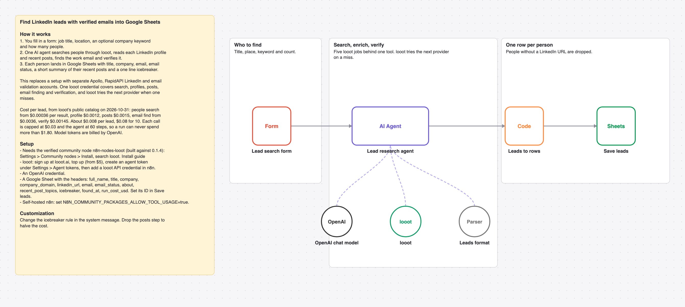

# Find and enrich LinkedIn leads with verified emails using one AI agent and looot

A form takes a job title, a location and a count. One AI agent searches people, reads their LinkedIn profiles and posts, finds and verifies the work email, writes an icebreaker and saves each lead to Google Sheets.

_The picture is drawn from `workflow.json`, not taken in n8n._

## Before and after

This rebuilds [Generate & enrich LinkedIn leads with Apollo.io, LinkedIn API, Mail.so & GPT-3.5](https://n8n.io/workflows/3791) by Joseph (25,900 views on n8n.io on 2026-10-31) with one AI agent and looot as its only data tool. Counts come from each workflow's JSON; sticky notes are not counted.

| | Original | This version |
| --- | --- | --- |
| Nodes | 56 | 7 |
| Data API accounts | 4 (Apify, Apollo, Mail.so, RapidAPI) | 1 (looot) |
| Accounts to set up in total | 6 (Apify, Apollo, Google, Mail.so, OpenAI, RapidAPI) | 3 (looot API, OpenAI, Google Sheets) |
| Cost cap per data call | none set in the JSON | $0.03 (Max Cost on the looot node) |

The original also keeps a lead table up to date on schedules and Google Sheets triggers. This rebuild does the search and enrichment in one form run, at most 10 people. The original offers Apify as an alternative to RapidAPI, so in practice it needs 3 of the 4 data accounts.

## Cost

Prices are the cheapest listed in looot's public catalog on 2026-10-31 (`GET https://api.looot.ai/v1/catalog/overview?depth=jobs`, no token). looot shows the price of every endpoint before a run, and a failed call costs $0.

| looot call | Price | Calls per run |
| --- | --- | --- |
| `job:people.search` | from $0.00036 per result | 1 |
| `job:linkedin.person.profile` | $0.0012 | 1 per person |
| `job:linkedin.person.posts` | $0.0015 | 1 per person |
| `job:people.email.find` | from $0.0036 | 1 per person |
| `job:people.email.verify` | $0.00145 | 1 per email found |

Typical: about $0.008 per lead. Most one run can spend in looot calls: $1.80 (60 agent steps x $0.03 cap). Model tokens are billed by your model provider.

## Set up

1. Install the community node [n8n-nodes-looot](https://www.npmjs.com/package/n8n-nodes-looot) 0.1.4, verified by n8n: Settings > Community nodes > Install, search `looot`. On self-hosted n8n with an AI agent, also set `N8N_COMMUNITY_PACKAGES_ALLOW_TOOL_USAGE=true`.
2. Sign up at [looot.ai](https://looot.ai), top up (from $5) and create an agent token with `catalog.read`, `runs.read`, `runs.execute`, `usage.read`. In n8n add a **looot API** credential with it.
3. Import `workflow.json` (Workflows > Import from File) and pick your credentials: looot API, OpenAI, Google Sheets.
4. Create a sheet tab named Leads with the headers full_name, title, company, company_domain, linkedin_url, email, email_status, about, recent_post_topics, icebreaker, found_at, run_cost_usd.

## What was checked

- `npm test`: node types and typeVersions against n8n's source at the n8n@2.44.3 tag and n8n-nodes-looot 0.1.4, connections, no credentials or ids in the JSON, sticky note rules, and every Code node run with fake inputs.
- `npm run check:params`: every parameter name exists in the node's source at that tag.
- Not run end to end in n8n. No live looot, model or destination calls were made.
