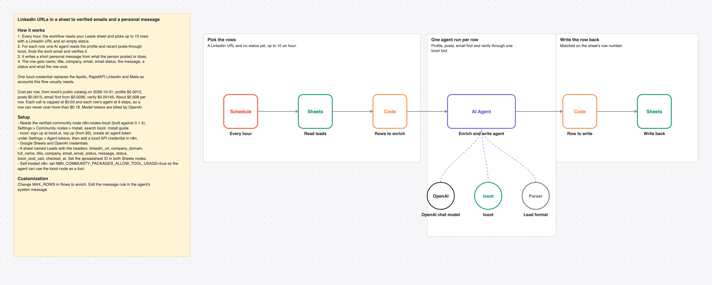

# Add verified emails and a personal message to LinkedIn leads in Google Sheets with one AI agent and looot

Every hour, rows in a Google Sheet that have a LinkedIn URL and no status get an agent run: profile, recent posts, work email, verification and a short personal message, written back to the row.

_The picture is drawn from `workflow.json`, not taken in n8n._

## Before and after

This rebuilds [Lead generation automate on LinkedIn - personalisation, enrichment](https://n8n.io/workflows/4685) by Krupal Patel (20,786 views on n8n.io on 2026-10-31) with one AI agent and looot as its only data tool. Counts come from each workflow's JSON; sticky notes are not counted.

| | Original | This version |
| --- | --- | --- |
| Nodes | 47 | 9 |
| Data API accounts | 3 (Apollo, Mails.so, RapidAPI) | 1 (looot) |
| Accounts to set up in total | 5 (Apollo, Google, Mails.so, OpenAI, RapidAPI) | 3 (looot API, OpenAI, Google Sheets) |
| Cost cap per data call | none set in the JSON | $0.03 (Max Cost on the looot node) |

The original also searches Apollo from a form to fill the sheet and runs several schedules over a self-hosted helper. This rebuild starts from LinkedIn URLs you already have. To fill the sheet from a search, use [linkedin-lead-enrichment-agent](../linkedin-lead-enrichment-agent) first.

## Cost

Prices are the cheapest listed in looot's public catalog on 2026-10-31 (`GET https://api.looot.ai/v1/catalog/overview?depth=jobs`, no token). looot shows the price of every endpoint before a run, and a failed call costs $0.

| looot call | Price | Calls per run |
| --- | --- | --- |
| `job:linkedin.person.profile` | $0.0012 | 1 per row |
| `job:linkedin.person.posts` | $0.0015 | 1 per row |
| `job:people.email.find` | from $0.0036 | 1 per row |
| `job:people.email.verify` | $0.00145 | 1 per email found |

Typical: about $0.008 per row. Most it can spend in looot calls: $0.18 per row (6 agent steps x $0.03 cap), $1.80 per hourly run of 10 rows. Model tokens are billed by your model provider.

## Set up

1. Install the community node [n8n-nodes-looot](https://www.npmjs.com/package/n8n-nodes-looot) 0.1.4, verified by n8n: Settings > Community nodes > Install, search `looot`. On self-hosted n8n with an AI agent, also set `N8N_COMMUNITY_PACKAGES_ALLOW_TOOL_USAGE=true`.
2. Sign up at [looot.ai](https://looot.ai), top up (from $5) and create an agent token with `catalog.read`, `runs.read`, `runs.execute`, `usage.read`. In n8n add a **looot API** credential with it.
3. Import `workflow.json` (Workflows > Import from File) and pick your credentials: looot API, OpenAI, Google Sheets.
4. Create a sheet tab named Leads with the headers linkedin_url, company_domain, full_name, title, company, email, email_status, message, status, looot_cost_usd, checked_at, and set the spreadsheet ID in **Read leads** and **Write back**.

## What was checked

- `npm test`: node types and typeVersions against n8n's source at the n8n@2.44.3 tag and n8n-nodes-looot 0.1.4, connections, no credentials or ids in the JSON, sticky note rules, and every Code node run with fake inputs.
- `npm run check:params`: every parameter name exists in the node's source at that tag.
- Not run end to end in n8n. No live looot, model or destination calls were made.
