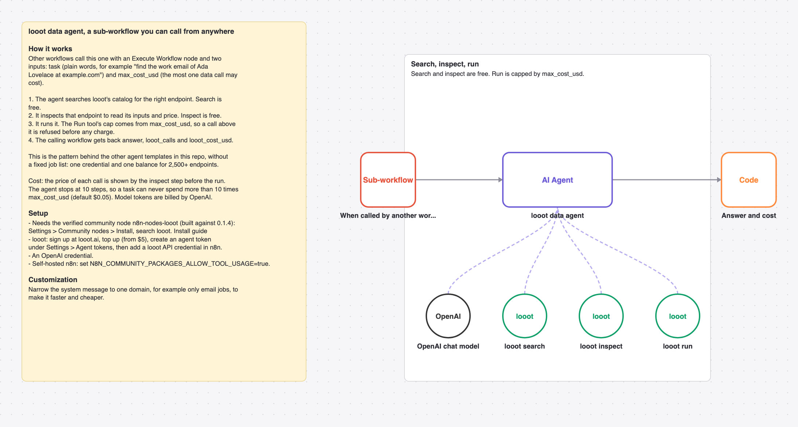

# Reusable looot data agent: call it from any workflow with a task and a cost cap

A sub-workflow any workflow can call with a task in plain words and a cost cap. The agent searches looot's catalog, inspects the endpoint's price and inputs, runs it and returns the answer with its cost.

_The picture is drawn from `workflow.json`, not taken in n8n._

## Cost

Prices are the cheapest listed in looot's public catalog on 2026-10-31 (`GET https://api.looot.ai/v1/catalog/overview?depth=jobs`, no token). looot shows the price of every endpoint before a run, and a failed call costs $0.

| looot call | Price | Calls per run |
| --- | --- | --- |
| `Search catalog` | free | 1 or more |
| `Inspect endpoint` | free | 1 |
| `Run` | the inspected price | 1 to a few |

Typical: the price inspect shows, usually under a cent for one lookup. Most one run can spend in looot calls: 10 x max_cost_usd (default $0.50). Model tokens are billed by your model provider.

## Set up

1. Install the community node [n8n-nodes-looot](https://www.npmjs.com/package/n8n-nodes-looot) 0.1.4, verified by n8n: Settings > Community nodes > Install, search `looot`. On self-hosted n8n with an AI agent, also set `N8N_COMMUNITY_PACKAGES_ALLOW_TOOL_USAGE=true`.
2. Sign up at [looot.ai](https://looot.ai), top up (from $5) and create an agent token with `catalog.read`, `runs.read`, `runs.execute`, `usage.read`. In n8n add a **looot API** credential with it.
3. Import `workflow.json` (Workflows > Import from File) and pick your credentials: looot API, OpenAI.
4. Call it from another workflow with an **Execute Workflow** node, inputs `task` and `max_cost_usd`.

## What was checked

- `npm test`: node types and typeVersions against n8n's source at the n8n@2.44.3 tag and n8n-nodes-looot 0.1.4, connections, no credentials or ids in the JSON, sticky note rules, and every Code node run with fake inputs.
- `npm run check:params`: every parameter name exists in the node's source at that tag.
- Not run end to end in n8n. No live looot, model or destination calls were made.
