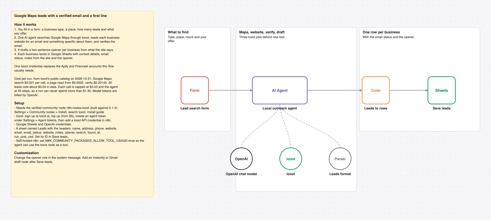

# Find Google Maps leads with verified emails and a drafted opener using one AI agent and looot

A form takes a business type, a place, a count and your offer. One AI agent searches Google Maps, reads each website, verifies the email it finds and drafts a two sentence opener, then each business lands in Google Sheets.

_The picture is drawn from `workflow.json`, not taken in n8n._

## Before and after

This rebuilds [Google Maps lead scraper & enrichment with AI-powered personalized outreach](https://n8n.io/workflows/6091) by A Z (5,450 views on n8n.io on 2026-10-31) with one AI agent and looot as its only data tool. Counts come from each workflow's JSON; sticky notes are not counted.

| | Original | This version |
| --- | --- | --- |
| Nodes | 21 | 7 |
| Data API accounts | 2 (Apify, Firecrawl) | 1 (looot) |
| Accounts to set up in total | 4 (Apify, Firecrawl, Google, OpenAI) | 3 (looot API, OpenAI, Google Sheets) |
| Cost cap per data call | none set in the JSON | $0.03 (Max Cost on the looot node) |

The original reads its searches from a sheet trigger and writes several sheets. This rebuild runs from a form and writes one tab. Compared with this repo's [google-maps-leads-agent](../google-maps-leads-agent), it adds email verification and a drafted opener.

## Cost

Prices are the cheapest listed in looot's public catalog on 2026-10-31 (`GET https://api.looot.ai/v1/catalog/overview?depth=jobs`, no token). looot shows the price of every endpoint before a run, and a failed call costs $0.

| looot call | Price | Calls per run |
| --- | --- | --- |
| `job:maps.local.search` | $0.001 per call | 1 to 2 |
| `job:web.scrape.markdown` | from $0.0002 per page | 1 to 2 per business |
| `job:people.email.verify` | $0.00145 | 1 per email found |

Typical: about $0.04 for 20 leads. Most it can spend in looot calls: $1.35 (45 agent steps x $0.03 cap). Model tokens are billed by your model provider.

## Set up

1. Install the community node [n8n-nodes-looot](https://www.npmjs.com/package/n8n-nodes-looot) 0.1.4, verified by n8n: Settings > Community nodes > Install, search `looot`. On self-hosted n8n with an AI agent, also set `N8N_COMMUNITY_PACKAGES_ALLOW_TOOL_USAGE=true`.
2. Sign up at [looot.ai](https://looot.ai), top up (from $5) and create an agent token with `catalog.read`, `runs.read`, `runs.execute`, `usage.read`. In n8n add a **looot API** credential with it.
3. Import `workflow.json` (Workflows > Import from File) and pick your credentials: looot API, OpenAI, Google Sheets.
4. Create a sheet tab named Leads with the headers name, address, phone, website, email, email_status, website_notes, opener, search, found_at, run_cost_usd, and set its ID in **Save leads**.

## What was checked

- `npm test`: node types and typeVersions against n8n's source at the n8n@2.44.3 tag and n8n-nodes-looot 0.1.4, connections, no credentials or ids in the JSON, sticky note rules, and every Code node run with fake inputs.
- `npm run check:params`: every parameter name exists in the node's source at that tag.
- Not run end to end in n8n. No live looot, model or destination calls were made.
