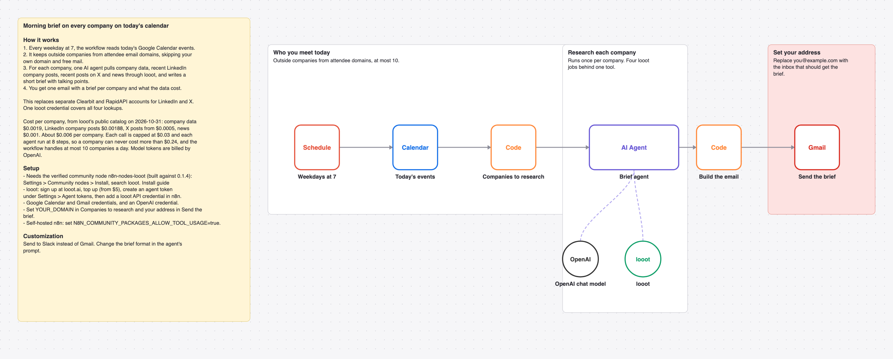

# Email yourself a brief on every company you meet today with one AI agent and looot

Every weekday at 7, read today's calendar, keep outside companies, have one AI agent pull company data, LinkedIn company posts, X posts and news, and email you a brief per company.

_The picture is drawn from `workflow.json`, not taken in n8n._

## Before and after

This rebuilds [Summarize social media activity of a company before a call](https://n8n.io/workflows/2125) by Milorad Filipović (10,796 views on n8n.io on 2026-10-31) with one AI agent and looot as its only data tool. Counts come from each workflow's JSON; sticky notes are not counted.

| | Original | This version |
| --- | --- | --- |
| Nodes | 18 | 8 |
| Data API accounts | 2 (Clearbit, RapidAPI) | 1 (looot) |
| Accounts to set up in total | 4 (Clearbit, Google, OpenAI, RapidAPI) | 4 (looot API, OpenAI, Google Calendar, Gmail) |
| Cost cap per data call | none set in the JSON | $0.03 (Max Cost on the looot node) |

Same job as the original. The original reads LinkedIn and X through two RapidAPI APIs and the company through Clearbit.

## Cost

Prices are the cheapest listed in looot's public catalog on 2026-10-31 (`GET https://api.looot.ai/v1/catalog/overview?depth=jobs`, no token). looot shows the price of every endpoint before a run, and a failed call costs $0.

| looot call | Price | Calls per run |
| --- | --- | --- |
| `job:company.enrich` | $0.0019 | 1 per company |
| `job:linkedin.company.posts` | $0.00188 | 0 to 1 |
| `job:x.user.posts` | from $0.0005 | 0 to 1 |
| `job:news.search` | $0.001 | 1 |

Typical: about $0.006 per company. Most one run can spend in looot calls: $0.24 per company (8 steps x $0.03), 10 companies a day at most. Model tokens are billed by your model provider.

## Set up

1. Install the community node [n8n-nodes-looot](https://www.npmjs.com/package/n8n-nodes-looot) 0.1.4, verified by n8n: Settings > Community nodes > Install, search `looot`. On self-hosted n8n with an AI agent, also set `N8N_COMMUNITY_PACKAGES_ALLOW_TOOL_USAGE=true`.
2. Sign up at [looot.ai](https://looot.ai), top up (from $5) and create an agent token with `catalog.read`, `runs.read`, `runs.execute`, `usage.read`. In n8n add a **looot API** credential with it.
3. Import `workflow.json` (Workflows > Import from File) and pick your credentials: looot API, OpenAI, Google Calendar, Gmail.
4. Set YOUR_DOMAIN in **Companies to research** and your address in **Send the brief**.

## What was checked

- `npm test`: node types and typeVersions against n8n's source at the n8n@2.44.3 tag and n8n-nodes-looot 0.1.4, connections, no credentials or ids in the JSON, sticky note rules, and every Code node run with fake inputs.
- `npm run check:params`: every parameter name exists in the node's source at that tag.
- Not run end to end in n8n. No live looot, model or destination calls were made.
