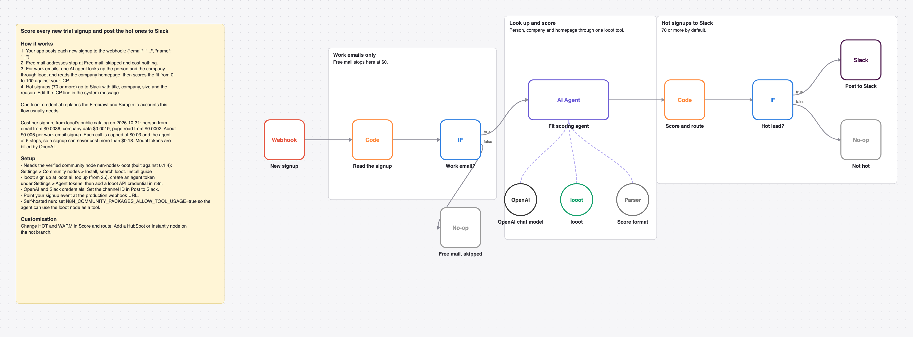

# Score new trial signups against your ICP with one AI agent and looot and alert Slack on hot leads

Your app posts each new trial signup to a webhook. Free mail stops at $0. For work emails, one AI agent looks up the person and the company and reads the homepage, scores the fit from 0 to 100, and hot signups go to Slack.

_The picture is drawn from `workflow.json`, not taken in n8n._

## Before and after

This rebuilds [Score and route new trial leads with Firecrawl, Scrapin.io, OpenAI, Slack and Instantly](https://n8n.io/workflows/13644) by Brandon Charleson (1,285 views on n8n.io on 2026-10-31) with one AI agent and looot as its only data tool. Counts come from each workflow's JSON; sticky notes are not counted.

| | Original | This version |
| --- | --- | --- |
| Nodes | 48 | 12 |
| Data API accounts | 2 (Firecrawl, Scrapin.io) | 1 (looot) |
| Accounts to set up in total | 5 (Firecrawl, Instantly, OpenAI, Scrapin.io, Slack) | 3 (looot API, OpenAI, Slack) |
| Cost cap per data call | none set in the JSON | $0.03 (Max Cost on the looot node) |

The original also routes warm leads into Instantly sequences and waits and retries between steps. This rebuild scores and alerts; add an Instantly node on the hot branch if you want the sequence. The repo's core-node [signup-qualifier](../signup-qualifier) scores with fixed rules and no LLM; this one reads the website and explains the score.

## Cost

Prices are the cheapest listed in looot's public catalog on 2026-10-31 (`GET https://api.looot.ai/v1/catalog/overview?depth=jobs`, no token). looot shows the price of every endpoint before a run, and a failed call costs $0.

| looot call | Price | Calls per run |
| --- | --- | --- |
| `job:people.enrich.by-email` | from $0.0036 | 1 |
| `job:company.enrich` | $0.0019 | 1 |
| `job:web.scrape.markdown` | from $0.0002 per page | 1 |

Typical: about $0.006 per work email signup, $0 for free mail. Most it can spend in looot calls: $0.18 per signup (6 agent steps x $0.03 cap). Model tokens are billed by your model provider.

## Set up

1. Install the community node [n8n-nodes-looot](https://www.npmjs.com/package/n8n-nodes-looot) 0.1.4, verified by n8n: Settings > Community nodes > Install, search `looot`. On self-hosted n8n with an AI agent, also set `N8N_COMMUNITY_PACKAGES_ALLOW_TOOL_USAGE=true`.
2. Sign up at [looot.ai](https://looot.ai), top up (from $5) and create an agent token with `catalog.read`, `runs.read`, `runs.execute`, `usage.read`. In n8n add a **looot API** credential with it.
3. Import `workflow.json` (Workflows > Import from File) and pick your credentials: looot API, OpenAI, Slack.
4. Edit the ICP line in the agent's system message, set the channel ID in **Post to Slack**, and send `{"email": "...", "name": "..."}` to the production webhook URL.

## What was checked

- `npm test`: node types and typeVersions against n8n's source at the n8n@2.44.3 tag and n8n-nodes-looot 0.1.4, connections, no credentials or ids in the JSON, sticky note rules, and every Code node run with fake inputs.
- `npm run check:params`: every parameter name exists in the node's source at that tag.
- Not run end to end in n8n. No live looot, model or destination calls were made.
