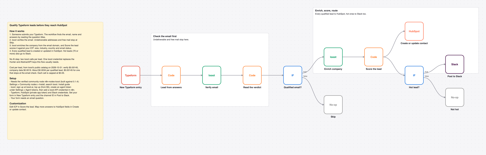

# Verify, enrich and score Typeform leads with looot, save them to HubSpot and alert Slack on hot ones

Each Typeform submission is verified, enriched from the email domain and scored against your ICP. Qualified leads go to HubSpot, hot ones also to Slack.

_The picture is drawn from `workflow.json`, not taken in n8n._

## Before and after

This rebuilds [Smart Lead Qualification & Routing from Typeform to HubSpot with Data Enrichment](https://n8n.io/workflows/10203) by Adem Tasin (348 views on n8n.io on 2026-10-31) with looot as its only data source. Counts come from each workflow's JSON; sticky notes are not counted.

| | Original | This version |
| --- | --- | --- |
| Nodes | 13 | 12 |
| Data API accounts | 2 (AbstractAPI, Hunter) | 1 (looot) |
| Accounts to set up in total | 5 (AbstractAPI, Google, HubSpot, Hunter, Slack) | 4 (Typeform, looot API, HubSpot, Slack) |
| Cost cap per data call | none set in the JSON | $0.05 (Max Cost on the looot node) |

The original receives Typeform through a plain webhook, pastes Hunter and AbstractAPI keys into HTTP nodes and logs every lead to a sheet. This rebuild uses the Typeform trigger and drops the sheet log. It has one node fewer, not many: the gain is one data account instead of two, and no keys in the JSON.

## Cost

Prices are the cheapest listed in looot's public catalog on 2026-10-31 (`GET https://api.looot.ai/v1/catalog/overview?depth=jobs`, no token). looot shows the price of every endpoint before a run, and a failed call costs $0.

| looot call | Price | Calls per run |
| --- | --- | --- |
| `job:people.email.verify` | $0.00145 | 1 per lead |
| `job:company.enrich` | $0.0019 | 1 per qualified lead |

Typical: about $0.0034 per qualified lead. Most it can spend in looot calls: $0.10 per lead (2 calls x $0.05 cap).

## Set up

1. Install the community node [n8n-nodes-looot](https://www.npmjs.com/package/n8n-nodes-looot) 0.1.4, verified by n8n: Settings > Community nodes > Install, search `looot`.
2. Sign up at [looot.ai](https://looot.ai), top up (from $5) and create an agent token with `catalog.read`, `runs.read`, `runs.execute`, `usage.read`. In n8n add a **looot API** credential with it.
3. Import `workflow.json` (Workflows > Import from File) and pick your credentials: Typeform, looot API, HubSpot (private app token), Slack.
4. Pick your form in **New Typeform entry** (it needs an email question), edit ICP in **Score the lead**, and set the channel ID in **Post to Slack**.

## What was checked

- `npm test`: node types and typeVersions against n8n's source at the n8n@2.44.3 tag and n8n-nodes-looot 0.1.4, connections, no credentials or ids in the JSON, sticky note rules, and every Code node run with fake inputs.
- `npm run check:params`: every parameter name exists in the node's source at that tag.
- Not run end to end in n8n. No live looot, model or destination calls were made.
