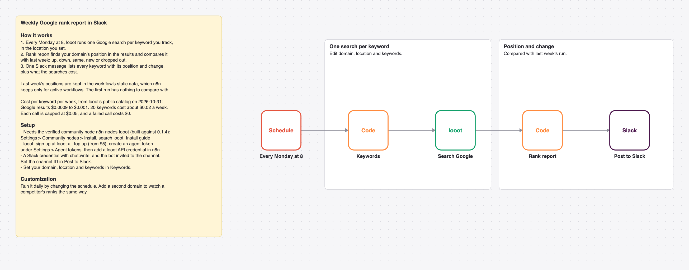

# Post a weekly Google rank report for your keywords to Slack with looot

Every Monday, one Google search per tracked keyword. One Slack message lists your position per keyword and the change since last week.

_The picture is drawn from `workflow.json`, not taken in n8n._

## Cost

Prices are the cheapest listed in looot's public catalog on 2026-10-31 (`GET https://api.looot.ai/v1/catalog/overview?depth=jobs`, no token). looot shows the price of every endpoint before a run, and a failed call costs $0.

| looot call | Price | Calls per run |
| --- | --- | --- |
| `job:google.serp.organic` | $0.0009 to $0.001 | 1 per keyword per week |

Typical: about $0.02 a week for 20 keywords. Most it can spend in looot calls: $0.05 per keyword per week.

## Set up

1. Install the community node [n8n-nodes-looot](https://www.npmjs.com/package/n8n-nodes-looot) 0.1.4, verified by n8n: Settings > Community nodes > Install, search `looot`.
2. Sign up at [looot.ai](https://looot.ai), top up (from $5) and create an agent token with `catalog.read`, `runs.read`, `runs.execute`, `usage.read`. In n8n add a **looot API** credential with it.
3. Import `workflow.json` (Workflows > Import from File) and pick your credentials: looot API, Slack.
4. Set your domain, location and keywords in **Keywords**, and the channel ID in **Post to Slack**. The core-node [google-rank-check](../google-rank-check) does a daily check over a webhook; this one reports weekly changes to Slack.

## What was checked

- `npm test`: node types and typeVersions against n8n's source at the n8n@2.44.3 tag and n8n-nodes-looot 0.1.4, connections, no credentials or ids in the JSON, sticky note rules, and every Code node run with fake inputs.
- `npm run check:params`: every parameter name exists in the node's source at that tag.
- Not run end to end in n8n. No live looot, model or destination calls were made.
